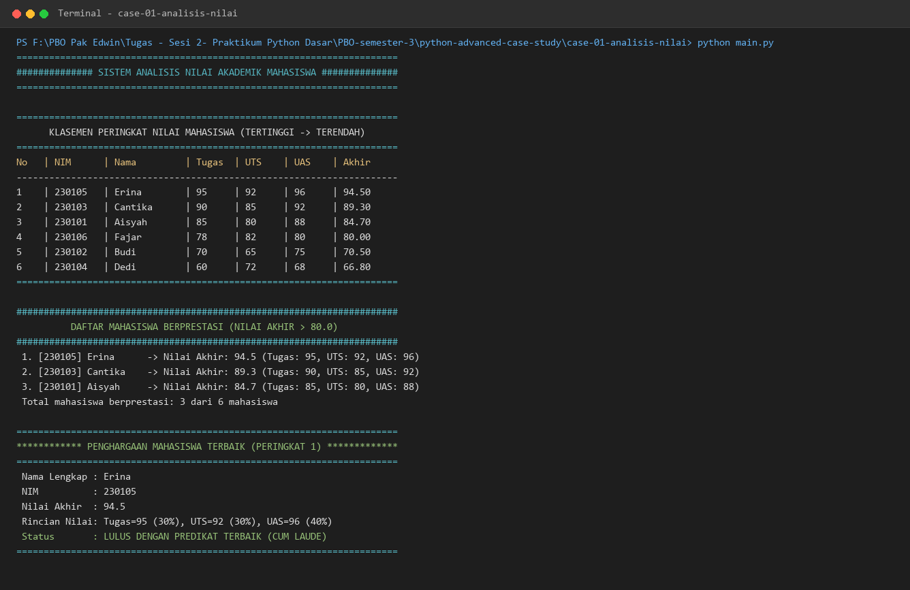

# Studi Kasus 1: Analisis Nilai Mahasiswa

## 📌 Deskripsi Masalah
Bagian akademik universitas menerima tumpukan data mentah nilai mahasiswa dalam bentuk *list of dictionaries*. Pendekatan konvensional dengan *nested for-loop* sering kali menghasilkan baris kode yang panjang, imperatif, dan sulit dipelihara. 

Tujuan dari program ini adalah membangun modul analisis data nilai mahasiswa yang ringkas, elegan, dan *Pythonic* dengan memanfaatkan fitur fungsional bawaan Python.

---

## 💡 Konsep Python yang Digunakan
1. **List Comprehension**: Digunakan untuk kalkulasi bobot nilai akhir secara langsung sekaligus mentransformasikan list data awal ke dalam dictionary baru.
   - Bobot resmi: Tugas (30%), UTS (30%), UAS (40%).
2. **Lambda Function**: Digunakan sebagai fungsi anonim satu baris untuk parameter `key` pada fungsi pengurutan `sorted()`.
3. **Filtering & Sorting Pythonic**:
   - Pemfilteran mahasiswa berprestasi (nilai akhir > 80.0) menggunakan kondisi deklaratif di dalam *list comprehension*.
   - Pemeringkatan (ranking) seluruh mahasiswa dari nilai tertinggi ke terendah menggunakan `sorted(..., key=lambda mhs: mhs["nilai_akhir"], reverse=True)`.

---

## 🚀 Cara Menjalankan Skrip
Pastikan berada pada direktori kasus ini atau direktori utama proyek, lalu jalankan perintah:

```bash
# Dari direktori case-01-analisis-nilai
python main.py
```

---

## 📷 Bukti Eksekusi Program (Terminal Output)
Berikut adalah tangkapan layar hasil eksekusi program `main.py`:



---

## 📊 Ringkasan Hasil Eksekusi
- **Total Mahasiswa**: 6 orang
- **Mahasiswa Berprestasi (Nilai > 80)**: 
  1. Erina (NIM: 230105) — Nilai Akhir: 94.50
  2. Cantika (NIM: 230103) — Nilai Akhir: 89.30
  3. Aisyah (NIM: 230101) — Nilai Akhir: 84.70
- **Mahasiswa Terbaik (Peringkat 1)**: **Erina** dengan Nilai Akhir **94.50** (Tugas: 95, UTS: 92, UAS: 96).
