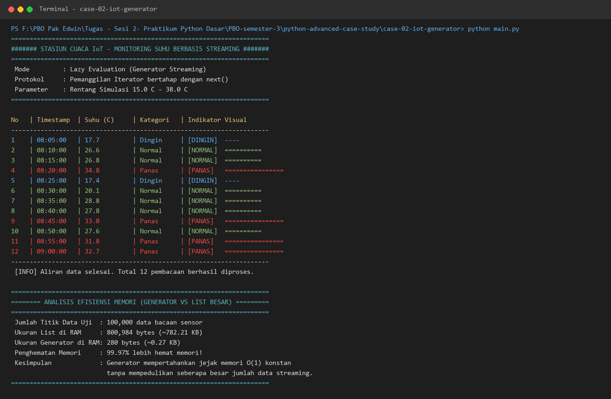

# Studi Kasus 2: Streaming Data Sensor IoT Hemat Memori

## 📌 Deskripsi Masalah
Sebuah stasiun pemantau cuaca mengirimkan ribuan hingga jutaan titik data bacaan sensor setiap jamnya. Jika seluruh data sensor tersebut dibaca lalu ditampung ke dalam list sekaligus (*eager evaluation*), memori RAM server atau perangkat mikrokomputer akan cepat habis (*Out of Memory*).

Tantangan pada studi kasus ini adalah membangun sistem penanganan data berbasis **aliran bertahap (*streaming*)**, di mana setiap titik data suhu hanya diproduksi dan diproses satu per satu saat benar-benar diminta (*lazy/on-demand*), bukan dimuat sekaligus ke RAM.

---

## 💡 Konsep Python yang Digunakan
1. **Generator Function & Kata Kunci `yield`**:
   - Fungsi `sensor_suhu_generator` menggunakan `yield` untuk mengembalikan data satu per satu, menahan status eksekusi fungsi, dan melanjutkannya kembali saat pemanggilan berikutnya.
2. **Iterator Pattern & `next()`**:
   - Konsumsi data dilakukan secara bertahap menggunakan built-in function `next()` dan menangani sinyal akhir data melalui exception `StopIteration`.
3. **Kategorisasi Status Suhu**:
   - `Dingin`: suhu < 20.0°C
   - `Normal`: 20.0°C <= suhu <= 30.0°C
   - `Panas`: suhu > 30.0°C
4. **Optimasi & Efisiensi Memori (*Memory Optimization*)**:
   - Penggunaan memori generator bernilai konstan $O(1)$ (hanya ~280 bytes) terlepas dari apakah memproses 10, 100 ribu, atau 10 juta data, dibandingkan list konvensional yang bertumbuh $O(n)$ secara linear di RAM.

---

## 🚀 Cara Menjalankan Skrip
Jalankan skrip `main.py` dari direktori `case-02-iot-generator`:

```bash
# Dari direktori case-02-iot-generator
python main.py
```

---

## 📷 Bukti Eksekusi Program (Terminal Output)
Berikut tangkapan layar output eksekusi program di terminal:



---

## 📊 Hasil Pengujian & Analisis Memori
- Menjalankan 12 pembacaan berturut-turut dengan variasi status **Dingin**, **Normal**, dan **Panas**.
- Pada pengujian beban 100.000 titik data sensor:
  - **List Konvensional**: Mengonsumsi **800.984 bytes (~782,21 KB)** di RAM.
  - **Generator Streaming**: Hanya mengonsumsi **280 bytes (~0,27 KB)** di RAM.
  - **Efisiensi Memori**: Menghemat **99,97%** penggunaan memori RAM.
