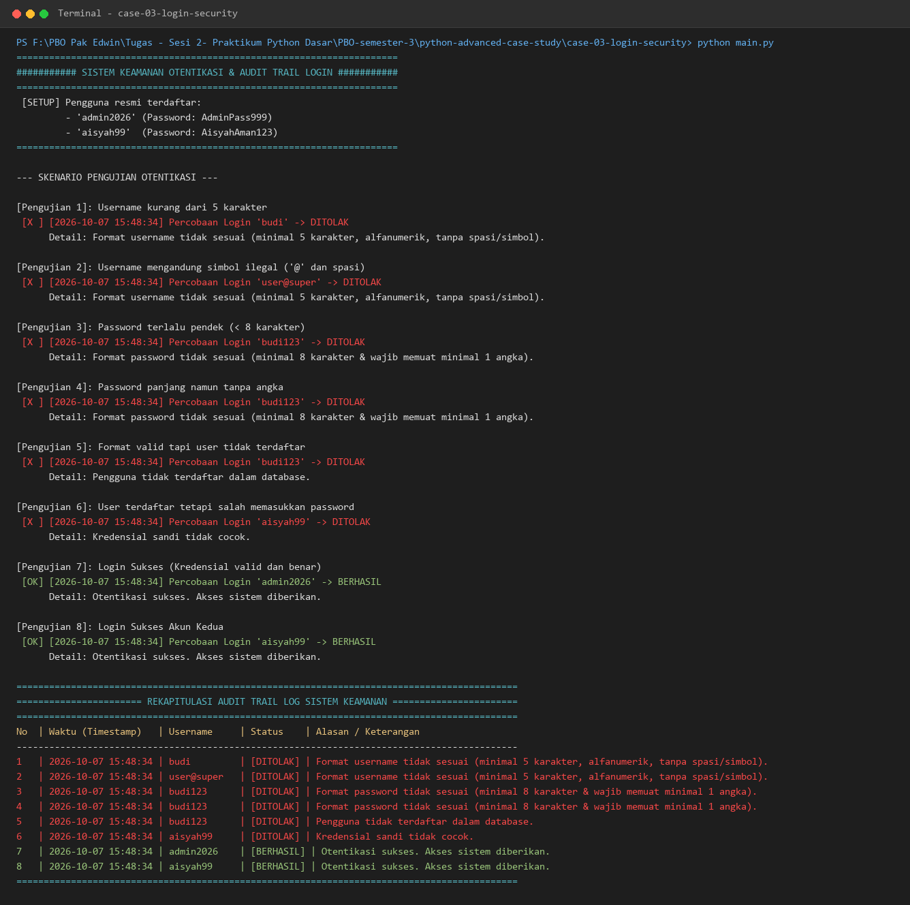

# Studi Kasus 3: Sistem Keamanan Akun & Audit Log Login

## 📌 Deskripsi Masalah
Dalam aplikasi produksi, mekanisme otentikasi akun membutuhkan verifikasi kredensial yang ketat untuk mencegah serangan injeksi dan penggunaan kata sandi yang lemah. Selain itu, sistem enterprise membutuhkan pencatatan riwayat (*audit trail*) otomatis terhadap seluruh upaya akses (baik berhasil maupun gagal) untuk keperluan forensik keamanan tanpa mengotori atau mengubah alur kode utama otentikasi.

Tujuan dari program ini adalah mengimplementasikan sistem login aman dengan validasi format berbasis ekspresi reguler (RegEx), enkapsulasi objek pengguna via `@property`, serta pencatatan audit log otomatis menggunakan *Python Decorator*.

---

## 💡 Konsep Python yang Digunakan
1. **Regular Expressions (`re` Module)**:
   - Validasi Username: `^[a-zA-Z0-9]{5,}$` (minimal 5 karakter, hanya alfanumerik huruf dan angka, tanpa spasi atau simbol).
   - Validasi Password: `^(?=.*\d).{8,}$` (minimal 8 karakter dan wajib memiliki setidaknya satu karakter angka).
2. **Property Decorator (`@property` & `@setter`)**:
   - Menerapkan prinsip enkapsulasi OOP elegan pada class `User`.
   - Mengontrol akses terhadap username dan menyembunyikan raw password (`password` getter mengembalikan `"********"`).
3. **Decorator & Closure (`@audit_trail`)**:
   - Membungkus fungsi `proses_login` secara transparan.
   - Otomatis mencatat metadata login:
     - Waktu percobaan login (*timestamp* presisi detik)
     - Username yang mencoba login
     - Status hasil: `BERHASIL` atau `DITOLAK`
     - Alasan / pesan penolakan jika gagal

---

## 🚀 Cara Menjalankan Skrip
Jalankan skrip `main.py` dari direktori `case-03-login-security`:

```bash
# Dari direktori case-03-login-security
python main.py
```

---

## 📷 Bukti Eksekusi Program (Terminal Output)
Berikut tangkapan layar output eksekusi program di terminal:



---

## 🧪 Skenario Pengujian yang Didemonstrasikan
Program mendemonstrasikan berbagai kemungkinan kasus otentikasi:
1. **Pengujian 1 (Format Username Pendek)**: Username `'budi'` ditolak karena kurang dari 5 karakter.
2. **Pengujian 2 (Simbol Ilegal Username)**: Username `'user@super'` ditolak karena memuat karakter `@`.
3. **Pengujian 3 (Format Password Pendek)**: Password `'Pass1'` ditolak karena kurang dari 8 karakter.
4. **Pengujian 4 (Password Tanpa Angka)**: Password `'passwordtanpaangka'` ditolak karena tidak memiliki angka.
5. **Pengujian 5 (User Tidak Terdaftar)**: Format valid namun kredensial belum ada di database sistem.
6. **Pengujian 6 (Password Salah)**: User terdaftar `'aisyah99'` gagal karena kata sandi salah.
7. **Pengujian 7 & 8 (Login Sukses)**: Seluruh aturan format terpenuhi dan kredensial cocok dengan akun terdaftar (`'admin2026'` dan `'aisyah99'`).
